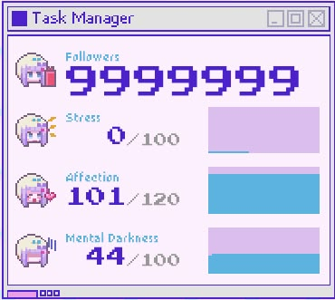

  

<h1 align="center">
  Athena Chang
</h1>

### ♡ About Me
<table>
  <tr>
    <td width="30%">
      
    </td>
    <td width="100%">
      <b>Hi, I'm Athena!</b>
        
      I'm an Electrical Engineering student at Purdue University interested in embedded systems and circuit design.
        
      Currently, I'm working on Medical Symptom Analyzer for Purdue EPICS as well as sRGB Image Processor in my free time.
        
      My skills:
        
      
      
      
    </td>
  </tr>
</table>

### ♡ Projects
<table>
  <tr>
    <td width="70%">
      <ul>
        <li><a href="https://master.her-med.pages.dev/"><b>Medical Symptom Analyzer</b></a>: An AI-assisted web app that analyzes user symptoms and ZIP code to provide local medical resources.</li>
        <li><a href="https://srgb-image-processor.onrender.com/"><b>sRGB Image Processor</b></a>: Web app that uses a NumPy array to load an image to compute the mean intensity per RGB channel.</li>
        <li>Project 3 Placeholder Text</li>
        <li>Project 4 Placeholder Text</li>
      </ul>
    </td>
    <td width="30%">
      
    </td>
  </tr>
</table>

### ♡ Contact

  
  

